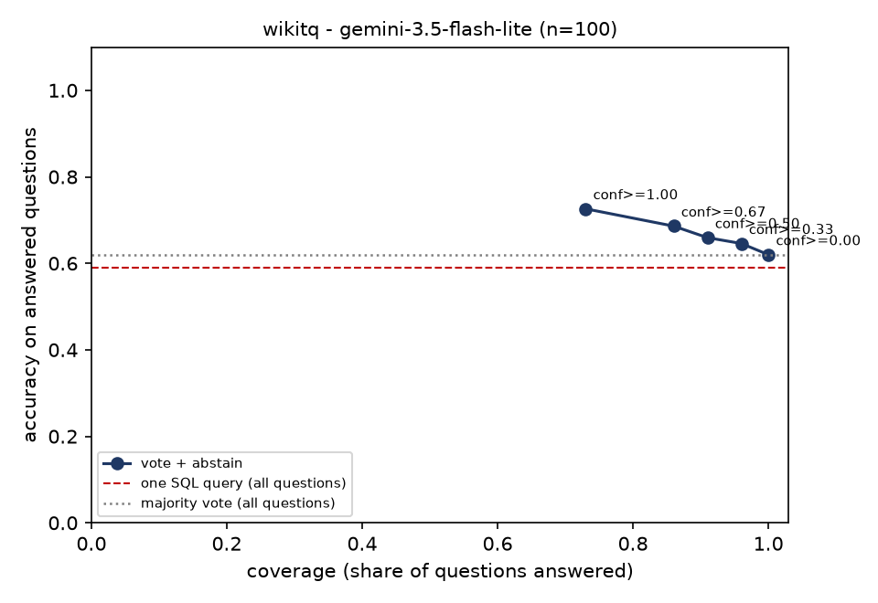
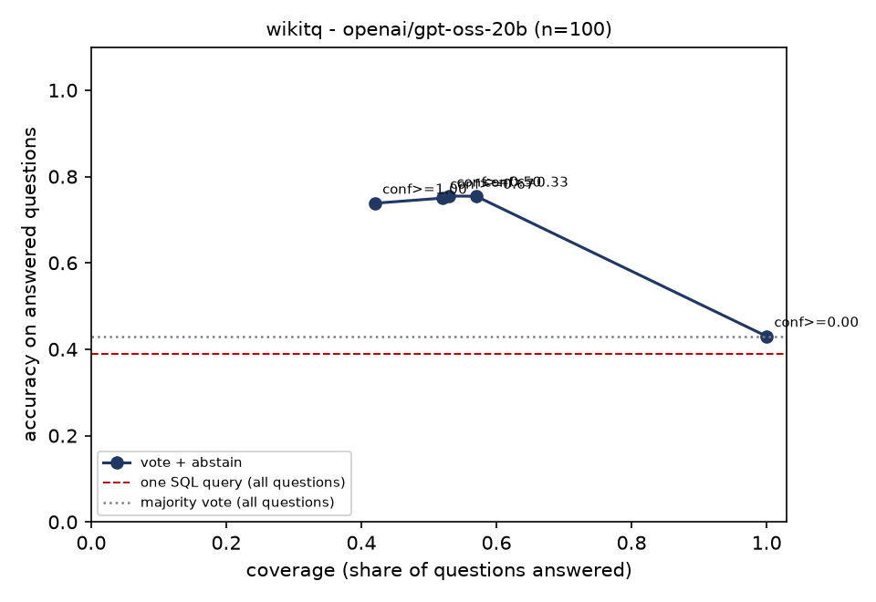

# Verified Table QA

**Can a language model learn to say "I'm not sure" about its own SQL?**

A model reads a question about a table and writes SQL. We run that SQL and ask how far the answer can be trusted. The system asks for **three queries from three different prompts**, executes all of them in a read-only SQLite sandbox, returns the **majority answer**, and **abstains** when too few queries agree or a symbolic sanity check fails. Every result is reported with bootstrap confidence intervals, paired tests and **coverage**, never accuracy alone.

> The method itself is not new: it combines self-consistency, execution-based selection and selective prediction. The value of the project is a careful, reproducible evaluation and an honest error analysis.

---

## Results

All numbers below are computed from the raw `predictions.jsonl` files in `results/`. Setup for every WikiTQ run: 100 questions from the WikiTableQuestions development split (seed 7, tables up to 60 rows and 12 columns), 3 queries per question, temperature 0, confidence threshold 0.66 (at least 2 of 3 queries agree). 95% bootstrap intervals in brackets.

### Groq `gpt-oss-20b` vs Gemini 3.5 Flash-Lite on WikiTQ

**Important:** the last 32 questions of the Groq run (questions 69 to 100) failed with `HTTP 401: Invalid API Key`, so the "as recorded" numbers compare a complete run with a broken one. The fair comparison is on the **68 shared questions with valid responses**.

| 68 shared valid questions | Groq `gpt-oss-20b` | Gemini 3.5 Flash-Lite |
|---|---|---|
| One query (B) | 57.4% [45.6, 69.1] | 60.3% [48.5, 72.1] |
| Majority vote of 3 (C) | 63.2% [51.5, 73.5] | 64.7% [52.9, 75.0] |
| Vote minus one query | +5.9 [+1.5, +11.8] | +4.4 [0.0, +10.3] |
| Vote + abstain: accuracy on answered | 75.0% [63.0, 86.3] | 71.7% [60.3, 82.5] |
| Vote + abstain: coverage | 76.5% [66.2, 85.3] | 88.2% [80.9, 95.6] |
| AUROC of the confidence score | 0.702 [0.571, 0.823] | 0.624 [0.515, 0.732] |
| Queries that executed (of 204) | 175 (85.8%) | 203 (99.5%) |

Paired difference Gemini minus Groq in voted accuracy: **+1.5 points, 95% CI [-8.8, +11.8], exact McNemar p = 1.0**. On these questions the two systems cannot be told apart.

| As recorded (100 questions) | Groq `gpt-oss-20b` | Gemini 3.5 Flash-Lite |
|---|---|---|
| One query (B) | 39.0% [30.0, 49.0] | 59.0% [50.0, 68.0] |
| Majority vote of 3 (C) | 43.0% [34.0, 53.0] | 62.0% [53.0, 71.0] |
| Accuracy on answered / coverage | 75.0% / 52.0% | 68.6% / 86.0% |

The 19-point gap (McNemar p = 0.001) is mostly caused by the 401 errors and says little about model ability.

<p align="center">
  
  
</p>

### What the results show

- **Voting helps a little and never hurt.** It corrected 3 to 4 questions per model and changed no correct answer into a wrong one. The Gemini interval touches 0, so this is suggestive, not conclusive.
- **Agreement is informative.** On the shared questions, unanimous answers are right 70.9% (Gemini) and 73.8% (Groq) of the time; answers below the threshold only 12.5% and 25.0%.
- **Agreement is not correctness.** Even unanimous answers are wrong about one time in four, and on **12 of the 18** questions that both models get wrong, they give the *same* wrong answer.
- **Which model is better?** Gemini was the more *reliable system* (it always returned SQL), but the data do not show that it writes better SQL. `gpt-oss-20b` produced 24 replies without any SQL out of 204 requests, probably because its reasoning tokens used up the token limit. Gemini has higher coverage; Groq has slightly higher accuracy on the questions it answers.

### Synthetic sanity benchmark (`mini`, 60 questions, Groq `gpt-oss-20b`)

One query and the vote both score **100%** (Wilson 95% interval 94.0 to 100.0), coverage 100%. The benchmark is saturated, so it confirms that the pipeline works but cannot separate methods. The direct-reading baseline scored 36.7%, but **34 of its 60 answers were empty** (probably the 300-token limit), so that number is not valid evidence for or against SQL.

### What went wrong in the failures

Of Gemini's 41 single-query failures, a manual categorisation (see `results/wikitq_gemini/failures_to_audit.csv` and the technical report) gives: entity or value linking 7, misread question semantics 7, ordinal words such as "first" or "after" 4, messy numbers or dates 4, evaluation artefacts 4 (for example "4" against a gold answer of "4 years"), wrong column 3, "Total" row used as data 3, ambiguous questions or questionable gold answers 3, ties or incomplete sets 2, off-by-one durations 2, over-complex SQL 2. SQL syntax errors are almost absent (3 of 300 queries).

Wall-clock time and token usage were **not recorded**, so no speed comparison is available yet.

---

## How it works

```
 question + table schema
          |
          +--> ask the model for 3 SQL queries (3 different prompts)
          +--> run every query on a read-only SQLite copy of the table
          +--> compare the answers; the majority answer wins
          `--> confidence = (queries that agree) / 3, halved if a sanity check fails
                    |
         confidence >= 0.66 ?  --yes--> answer
                              `--no---> abstain ("I don't know")
```

| Method | Description | Answers every question? |
|---|---|---|
| A | **Direct**: the model reads the whole table and answers | yes |
| B | **One query**: schema only, one SQL query | yes |
| C | **Vote**: majority answer of 3 queries | yes |
| D | **Vote + abstain**: answer only if confident | only when confident |

Sanity checks (`vtqa/verify.py`): a "how many" question must return exactly one number (`type_mismatch`); a text answer must occur in a table cell (`ungrounded`); an empty or null result cannot vote. A query that crashes still counts in the denominator, so a model that often writes broken SQL loses confidence.

---

## Quick start

```bash
git clone https://github.com/Wareeday/verified-table-qa.git
cd verified-table-qa
python -m venv .venv
source .venv/bin/activate            # Windows: .venv\Scripts\activate
pip install -r requirements.txt

python tests/test_all.py             # 11 offline tests, ends with: ALL TESTS PASSED
python run.py --dataset mini --backend mock --n 30 --out results/demo_mock   # fake model, code test only
```

A mock run prints a **MOCK RUN** warning. Its numbers are meaningless and must never be quoted.

### Reproduce the real runs

```bash
export GROQ_API_KEY="..."      # Windows PowerShell: $env:GROQ_API_KEY="..."
export GEMINI_API_KEY="..."

python run.py --dataset wikitq --n 100 --preset groq   --model openai/gpt-oss-20b       --skip-direct --out results/wikitq_groq
python run.py --dataset wikitq --n 100 --preset gemini --model gemini-3.5-flash-lite     --skip-direct --out results/wikitq_gemini
python run.py --dataset mini   --n 60  --preset groq   --model openai/gpt-oss-20b                      --out results/mini_groq
```

Never put a key in the code or in Git. Free-tier limits change, so add `--sleep 2` if you hit rate limits. For a local model, install [Ollama](https://ollama.com), pull a model and use `--preset ollama --model <name>`. Any server that speaks the OpenAI chat-completions format works with `--base-url`.

Rebuild a report (for example with another threshold): `python -m vtqa.report results/wikitq_gemini 0.99`.

### Main options

| Option | Default | Meaning |
|---|---|---|
| `--dataset` | `mini` | `mini` (synthetic) or `wikitq` (real) |
| `--n`, `--seed` | 60, 7 | number of questions, sampling seed |
| `--preset` / `--base-url`, `--model` | none | `ollama`, `groq`, `gemini`, `openrouter` or your own server |
| `--k`, `--tau` | 3, 0.66 | queries per question, confidence threshold (choose before looking) |
| `--skip-direct` | off | skip the direct baseline to save calls |
| `--max-table-rows` | 60 | WikiTQ: skip longer tables |
| `--sleep` | 0 | seconds to wait after each call |
| `--out` | `results/run1` | output folder |

### What a run writes

| File | Content |
|---|---|
| `report.md`, `coverage_curve.png` | readable summary and the accuracy-coverage plot |
| `predictions.jsonl` | every question, query and answer (the raw evidence) |
| `failures_to_audit.csv` | wrong answers with an empty `your_label` column for manual error analysis |
| `summary.json`, `meta.json` | all numbers; model and settings |

## Repository layout

```
run.py                   command-line entry point
vtqa/                    prompts, LLM client, SQL sandbox, verifier, scoring, statistics, report, loaders
tests/test_all.py        offline tests
docs/EXPERIMENT_PLAN.md  hypotheses and settings
results/                 mini_groq, wikitq_groq, wikitq_gemini, run1 (partial)
```

## Known issues and roadmap

Found during a review of the code and results; none of them has been fixed yet.

- [ ] **Failed requests are treated as finished.** A re-run skips questions that already have a record, even when every request failed (as with the Groq HTTP 401 questions), so they are never retried. The run should also stop after repeated 401/403 errors.
- [ ] **Re-run Groq questions 69-100** after the fix above, then update the tables.
- [ ] **Token limits are fixed** (600 for SQL, 300 for direct answers) and not configurable. Reasoning models need more; add `--max-tokens` and store the raw reply and finish reason.
- [ ] **Re-run the direct baseline** on `mini` and on WikiTQ with a larger limit.
- [ ] **Wilson intervals** for proportions (bootstrap intervals collapse to [100, 100]).
- [ ] **More tolerant answer matching** (stray backslashes, units such as "4 years"), reported next to the strict score.
- [ ] **Record time and tokens** (`finished`, seconds per question, token counts) in `meta.json`.
- [ ] Fill in `failures_to_audit.csv` by hand (`your_label`) and complete `docs/EXPERIMENT_PLAN.md`.
- [ ] Packaging: `pyproject.toml` requires Python >= 3.14, but the code runs on older versions; remove the stub `src/verified_table_qa` or package `vtqa` properly.
- [ ] `results/run1` is an interrupted run (22 questions, no report); rename it or remove it.

## Limitations

Answers are compared as sets after simple normalisation. WikiTQ is public and filtered to small tables. The three prompts are not independent samples, and models can be consistently wrong. With 100 questions the intervals are wide, so small differences cannot be resolved. The mini benchmark is synthetic.

## Technical report

A full report (method, setup, tables, error analysis, references) is in `docs/technical_report.tex`.

## References

- P. Pasupat and P. Liang. *Compositional Semantic Parsing on Semi-Structured Tables.* ACL 2015.
- X. Wang et al. *Self-Consistency Improves Chain of Thought Reasoning in Language Models.* ICLR 2023.
- F. Shi et al. *Natural Language to Code Translation with Execution.* EMNLP 2022.
- R. El-Yaniv and Y. Wiener. *On the Foundations of Noise-free Selective Classification.* JMLR 2010.
- A. Kulkarni et al. *LLM-Symbolic Integration for Robust Temporal Tabular Reasoning.* Findings of ACL 2025.

## License

MIT