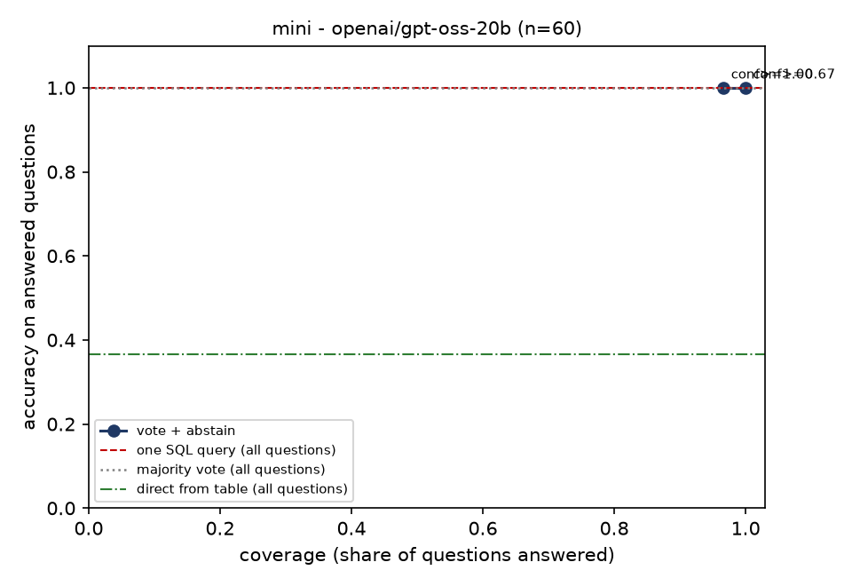

# Verified Table QA - run report

- Dataset: `mini`  |  Model: `openai/gpt-oss-20b`  |  Questions: **60**
- Queries per question (K): **3**  |  Confidence threshold: **0.66**  |  Seed: 7

## Headline numbers (95% bootstrap confidence intervals)

| Method | Accuracy | 95% CI |
|---|---|---|
| A. Direct from the table (no SQL) | 36.7% | 25.0% to 48.3% |
| B. SQL, one query | 100.0% | 100.0% to 100.0% |
| C. SQL, majority vote of K queries (answers everything) | 100.0% | 100.0% to 100.0% |
| D. Vote + abstain: accuracy on the questions it answered | 100.0% | 100.0% to 100.0% |
| D. Coverage (share of questions answered) | 100.0% | 100.0% to 100.0% |

Paired differences (same questions, so this is the fair comparison):

- Voting vs one query (C minus B): **+0.0 points**, 95% CI +0.0 to +0.0
- SQL vs direct (B minus A): **+63.3 points**, 95% CI +51.7 to +75.0

If a confidence interval for a difference includes 0, you cannot say the two methods differ at this sample size.

## Does the confidence score separate right from wrong?

- AUROC of confidence vs correctness: **nan** (95% CI nan to nan). 0.50 means the score is useless; 1.00 means perfect.
- Accuracy on answered questions: 100.0%. Accuracy on the questions it refused: n/a.

## Accuracy vs coverage (every possible threshold)

| confidence >= | coverage | accuracy on answered |
|---|---|---|
| 1.00 | 96.7% | 100.0% |
| 0.67 | 100.0% | 100.0% |

## By difficulty

| Difficulty | n | One query | Vote (all) | Vote + abstain accuracy | Coverage |
|---|---|---|---|---|---|
| easy | 19 | 100.0% | 100.0% | 100.0% | 100.0% |
| medium | 27 | 100.0% | 100.0% | 100.0% | 100.0% |
| hard | 14 | 100.0% | 100.0% | 100.0% | 100.0% |

## Why the single query was wrong (automatic first-pass labels)

No failures to label.

## Read this before you quote any number

- Method D answers fewer questions, so its accuracy is NOT comparable with A, B and C. Always quote accuracy together with coverage.
- With a small number of questions the confidence intervals are wide. Say so.
- Answers are compared as sets of values after simple normalisation (see `vtqa/scoring.py`).