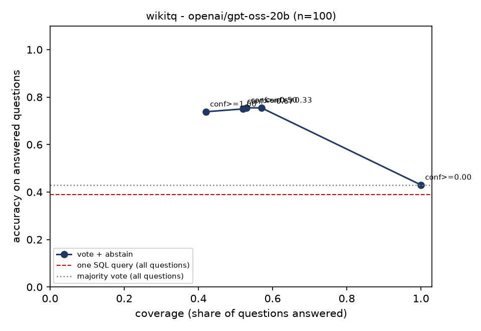

# Verified Table QA - run report

- Dataset: `wikitq`  |  Model: `openai/gpt-oss-20b`  |  Questions: **100**
- Queries per question (K): **3**  |  Confidence threshold: **0.66**  |  Seed: 7

## Headline numbers (95% bootstrap confidence intervals)

| Method | Accuracy | 95% CI |
|---|---|---|
| B. SQL, one query | 39.0% | 30.0% to 49.0% |
| C. SQL, majority vote of K queries (answers everything) | 43.0% | 34.0% to 53.0% |
| D. Vote + abstain: accuracy on the questions it answered | 75.0% | 63.3% to 86.0% |
| D. Coverage (share of questions answered) | 52.0% | 43.0% to 61.0% |

Paired differences (same questions, so this is the fair comparison):

- Voting vs one query (C minus B): **+4.0 points**, 95% CI +1.0 to +8.0

If a confidence interval for a difference includes 0, you cannot say the two methods differ at this sample size.

## Does the confidence score separate right from wrong?

- AUROC of confidence vs correctness: **0.87** (95% CI 0.80 to 0.93). 0.50 means the score is useless; 1.00 means perfect.
- Accuracy on answered questions: 75.0%. Accuracy on the questions it refused: 8.3%.

## Accuracy vs coverage (every possible threshold)

| confidence >= | coverage | accuracy on answered |
|---|---|---|
| 1.00 | 42.0% | 73.8% |
| 0.67 | 52.0% | 75.0% |
| 0.50 | 53.0% | 75.5% |
| 0.33 | 57.0% | 75.4% |
| 0.00 | 100.0% | 43.0% |

## Why the single query was wrong (automatic first-pass labels)

| Label | Count |
|---|---|
| llm_error | 32 |
| wrong_value | 13 |
| no_sql_found | 7 |
| empty_result | 5 |
| syntax_error | 2 |
| wrong_number_of_values | 2 |

These labels are automatic and rough. Open `failures_to_audit.csv`, read each failure and write your own label in the `your_label` column. That manual taxonomy is the most valuable part of this project.

Sanity-check flags raised on the voted answers: no_valid_query=43, type_mismatch=1, ungrounded=1

## Read this before you quote any number

- Method D answers fewer questions, so its accuracy is NOT comparable with A, B and C. Always quote accuracy together with coverage.
- With a small number of questions the confidence intervals are wide. Say so.
- Answers are compared as sets of values after simple normalisation (see `vtqa/scoring.py`).